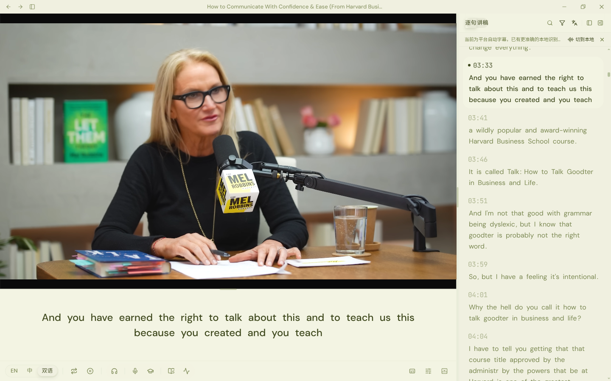
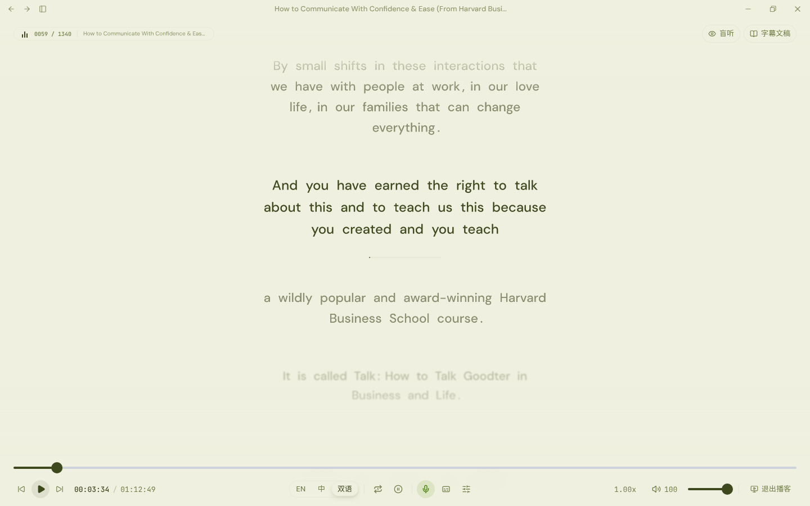

# CuminLang

An immersive media player and AI-native desktop language learning workspace.

English | [简体中文](./README.md)



## Features

### Immersive Playback and Subtitle Study
- Local video and audio playback powered by bundled `FFmpeg` / `FFprobe`, alongside a built-in YouTube link import queue (`yt-dlp`) integrated directly into the media library.
- Toggle between bilingual, original-only, translation-only, or hidden subtitles, paired with a dockable sentence transcript stream (left or right), single-sentence looping, A-B repeat, and playback rate controls.
- Full-screen Podcast listening mode (with blind-listening mode) and floating desktop lyrics for focused listening.



### Offline and Cloud-Assisted Subtitle Generation
- Built-in `whisper.cpp` (Vulkan on Linux/Windows `x64`, Metal on macOS Apple Silicon) and `sherpa-onnx` (cross-platform, including Windows `arm64`) generate accurate timestamped subtitles completely offline, with local speaker diarization support.
- Local vector indexing helps search and ground context across long lecture and video transcripts.

### Shadowing Practice and Script Reader
- Integrated Practice Dock with three modes: shadowing and dictation, A/B voice recording comparison, and rhythm/beat practice, all navigable via keyboard shortcuts (`R`, `S`, `Space`, `V`, `P`, etc.).
- Book-style Script Reader featuring vocabulary difficulty highlighting, instant built-in and imported dictionary lookups, bilingual study note export, and a streaming AI Study Copilot.
- Save sentences directly into Context Studio with original video audio clips, timestamps, and personal notes for spaced review.
- Run local LLMs via bundled `llama.cpp` or connect cloud providers (OpenAI Compatible, Anthropic, Google) per task.


### Theme System and LAN Mobile Access
- Seven curated theme families (`Neutral`, `Stone`, `Gothic`, `Matcha`, `Y2K`, `Butter`, `Chocolate`) with light/dark/system appearance, font scaling, and transcript panel dock controls.
- Optional LAN server lets mobile browsers on the same network access study materials and review workflows.


## Downloads and Supported Platforms

Download official `v1.0.0` and later builds from [GitHub Releases](https://github.com/kylesean/CuminLang/releases):

| Platform | Architecture | Package Format | Notes |
| --- | --- | --- | --- |
| macOS | Apple Silicon (`arm64`) | `.dmg` | Includes Metal-accelerated offline speech recognition (Apple Silicon only) |
| Windows | `x64` | `.msi` / `-Setup.exe` | Supports Vulkan-accelerated `whisper.cpp` and `sherpa-onnx` |
| Windows | `arm64` | `-Setup.exe` | Native ARM64 build; offline speech recognition uses `sherpa-onnx` |
| Linux | `x64` | `.deb` / `.rpm` / `.AppImage` | Supports Debian/Ubuntu, Fedora/RHEL, and universal AppImage |
| Arch Linux / Omarchy | `x86_64` | `.pkg.tar.zst` | Install directly via `sudo pacman -U cuminlang-*.pkg.tar.zst` |

## Development and Building from Source

Requirements:
- Node.js `22.22+` or `24.15+` (see `engines` in `package.json`)
- `pnpm`

```bash
# Install dependencies
pnpm install

# Download prebuilt native runtimes and media binaries (FFmpeg, sherpa-onnx, llama.cpp, whisper.cpp)
pnpm run download

# Start the Electron development environment
pnpm start
```

Verification and packaging commands:

```bash
# Lint and typecheck
pnpm run lint
pnpm run typecheck

# Unit tests and smoke E2E suite
pnpm run test:run
pnpm run test:e2e:smoke

# Package installers for the current platform
pnpm run make
```

## Acknowledgments

- [solidSpoon/DashPlayer](https://github.com/solidSpoon/DashPlayer): CuminLang forked from upstream DashPlayer at commit [`2cf57c69`](https://github.com/solidSpoon/DashPlayer/commit/2cf57c694b0015b51730c0c03abdfbc141feaf8b) (2026-11-07) and has evolved independently starting from commit [`0bd93e61`](https://github.com/kylesean/CuminLang/commit/0bd93e61bcf70fbe94b2ae1a9ce28d25f3224e5e) (2026-11-07). Thanks to the original author for the foundational work.
- Additional third-party notices are listed in [THIRD_PARTY_NOTICES.md](./THIRD_PARTY_NOTICES.md).

## License

Licensed under the [GNU Affero General Public License v3.0 (AGPL-3.0)](./LICENSE).
