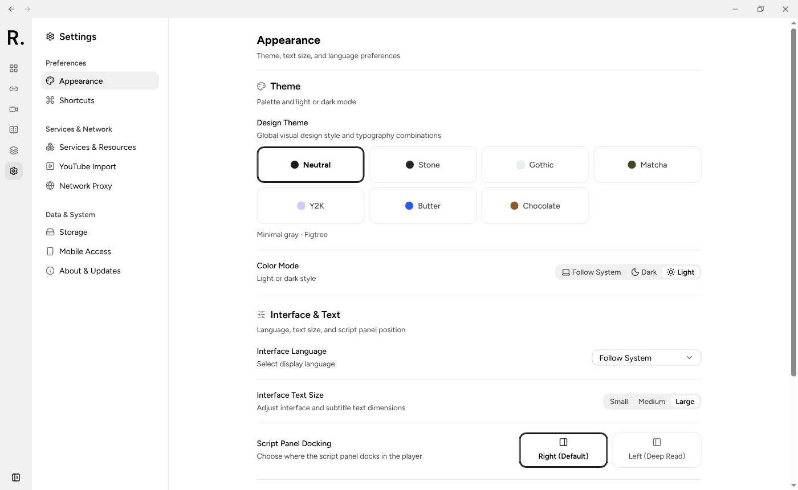

# Refrain

> An independently evolved and maintained modern media player & AI-native immersive language learning desktop app, originally forked from early versions of [solidSpoon/DashPlayer](https://github.com/solidSpoon/DashPlayer).

[简体中文](README.md) · [English](README.en.md)

<p>
  <a href="LICENSE" target="_blank">
    
  </a>
  <a href="https://github.com/kylesean/Refrain/releases/latest" target="_blank">
    
  </a>
  
  
  
</p>

---

## Key Features

- **Immersive Media & Bilingual Subtitle Playback**: Supports common video/audio formats and `srt` / `vtt` / `ass` subtitles with sentence navigation, single-sentence loop, auto-pause at line end, hardsub mask overlays, timeline shifting, full-text search, and Sentence / Article transcript views.
- **Full-Width Podcast Mode & Blind Listening**: Switch into a focused distraction-free podcast view with an auto-collapsed transcript sidebar, per-sentence progress bar, blind-listening veil, and hold-`\` keyboard peek.
- **Shadowing & Dictation Studio**: Practice pronunciation and dictation sentence by sentence with recording comparison, rhythm/prosody feedback, and spaced-repetition vocabulary consolidation.
- **AI Sentence Study & Context Studio**: Ask AI to break down grammar and usage within real subtitle context, look up words offline with the built-in ECDICT SQLite dictionary, and curate study notes.
- **Token-Protected LAN Mobile Access**: Stream your library and subtitles to mobile devices on the same network (see [`docs/MOBILE_FLUTTER_PLAN.md`](docs/MOBILE_FLUTTER_PLAN.md) for the upcoming cross-platform mobile roadmap).
- **Curated Theme Families**: Built-in Neutral, Stone, Gothic, Matcha, Y2K, Butter, and Chocolate themes with Light / Dark / Follow System modes.

---

## Screenshots

### Video Player & Bilingual Transcript


### Podcast Listening Mode


### Shadowing & Dictation Studio


### Settings & Themes


---

## Installation

Download installers for your OS from [Latest Release](https://github.com/kylesean/Refrain/releases/latest) (desktop binaries are not commercially signed yet; see notes below if OS security prompts appear):

- **macOS (`.dmg`, `arm64` / `x64`)**: Drag into `Applications`. If macOS blocks opening an unverified developer build, allow it in `System Settings → Privacy & Security` or run:
  ```bash
  xattr -c /Applications/Refrain.app
  ```
- **Windows (`.exe` / `.msi`)**: Run the installer; if SmartScreen prompts, click **More info → Run anyway**. Avoid mixing `.exe` and `.msi` installations side by side.
- **Linux (`.AppImage` / `.deb` / `.rpm`)**:
  ```bash
  # AppImage
  chmod +x Refrain-*.AppImage && ./Refrain-*.AppImage
  # If FUSE is unavailable, pass --appimage-extract-and-run or install libfuse2
  ```

---

## Development

Requirements: `Node.js` (see [`.nvmrc`](.nvmrc); supports `>=22.22.2 <23` or `>=24.15.0 <25`), `pnpm@10.x`, and `ffmpeg` / `ffprobe` (for E2E suites).

```bash
pnpm install
pnpm start                 # Build mobile web bundle and start Electron dev mode
pnpm run lint              # Run ESLint (zero warnings enforced)
pnpm run typecheck         # Run TypeScript compiler checks
pnpm run test:run          # Run Vitest unit tests
pnpm run test:e2e:smoke    # Run Playwright @smoke E2E checks
```

For E2E testing conventions and test suites, see the [E2E QA Guide](qa/README.md).

---

## Acknowledgments & License

- **[solidSpoon/DashPlayer](https://github.com/solidSpoon/DashPlayer)**: Refrain originated as a fork of DashPlayer; thanks to the original author for early exploration and open-source work.
- See [THIRD_PARTY_NOTICES.md](THIRD_PARTY_NOTICES.md) for bundled and on-demand open-source components and font notices.

Licensed under the [GNU Affero General Public License v3.0 (AGPL-3.0)](LICENSE).
