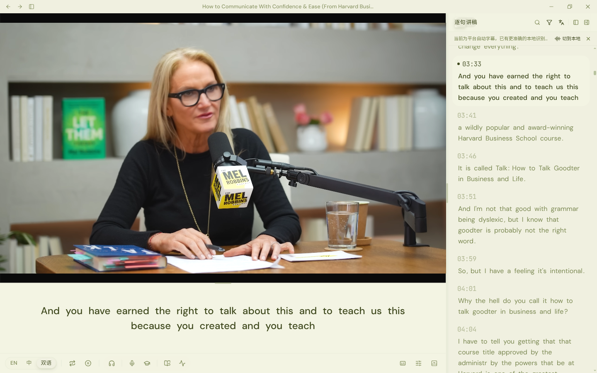
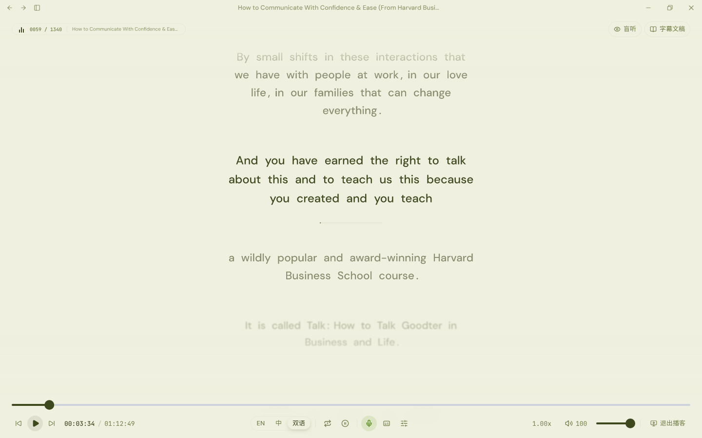
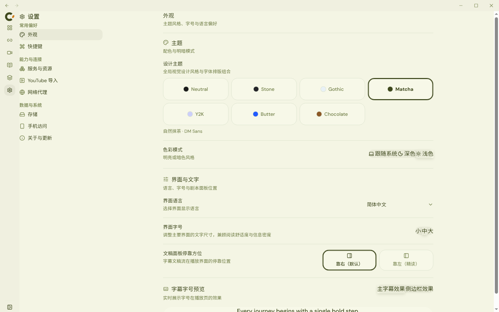

# CuminLang

面向沉浸式语言学习的现代音视频播放器与 AI 原生桌面学习工作台。

[English](./README.en.md) | 简体中文



## 特性

### 沉浸式播放与字幕精听
- 支持本地音视频播放（内置 `FFmpeg` / `FFprobe`）与 YouTube 链接导入（内置 `yt-dlp` 管理与任务队列），自动整理至媒体库。
- 支持双语、仅原文、仅译文与隐藏字幕切换，配合侧栏逐句讲稿流（可切换停靠左侧或右侧），支持单句复读、区间循环与倍速调节。
- 支持播客盲听模式与桌面悬浮字幕，兼顾专注听辨与多任务跟听。



### 离线与云端协同的字幕生成
- 集成 `whisper.cpp`（Linux / Windows `x64` 使用 Vulkan 加速，macOS Apple Silicon 使用 Metal 加速）与 `sherpa-onnx`（跨平台支持，含 Windows `arm64`），无字幕视频也可全离线生成高质量时间轴字幕，并提供本地声纹说话人识别分轨。
- 支持本地文本向量检索与上下文索引构建，帮助快速检索长视频讲稿片段。

### 跟读听写与精读工作台
- 内置三合一精练台（跟读听写、录音原音 A/B 对比、节拍流节奏跟读），支持直接通过快捷键（`R`、`S`、`Space`、`V`、`P` 等）闭眼盲操。
- 提供书卷式精读文稿（Script Reader），支持词频与生词难度标记、内置词典与外部词典即时查词、双语讲义导出，以及流式响应的 AI 精读搭档（Study Copilot）。
- 支持将重点例句一键收入语境工坊（Context Studio），保留视频原声片段、时间轴与个人笔记，并进入间隔复习流程。
- 同时内置 `llama.cpp` 本地模型运行时与云端 AI Provider 接入（OpenAI Compatible、Anthropic、Google），可按任务自由切换。


### 多主题设计与局域网伴侣
- 内置 7 套风格化主题家族：`Neutral`、`Stone`、`Gothic`、`Matcha`、`Y2K`、`Butter`、`Chocolate`，支持浅色、深色与跟随系统，以及字号和讲稿停靠方位调节。
- 内置局域网移动端访问服务，在设置中心一键开启后即可通过手机浏览器同步浏览与复习。



## 下载与支持平台

前往 [GitHub Releases](https://github.com/kylesean/CuminLang/releases) 下载 `v1.0.0` 及后续版本的对应平台安装包：

| 平台 | 架构 | 安装包格式 | 说明 |
| --- | --- | --- | --- |
| macOS | Apple Silicon (`arm64`) | `.dmg` | 支持 Metal 加速离线识别（暂不提供 Intel 芯片构建） |
| Windows | `x64` | `.msi` / `-Setup.exe` | 支持 Vulkan GPU 加速 `whisper.cpp` 与 `sherpa-onnx` |
| Windows | `arm64` | `-Setup.exe` | 原生 ARM64 构建，离线字幕生成使用 `sherpa-onnx` 引擎 |
| Linux | `x64` | `.deb` / `.rpm` / `.AppImage` | 适用于 Debian/Ubuntu、Fedora/RHEL 与通用发行版 |
| Arch Linux / Omarchy | `x86_64` | `.pkg.tar.zst` | 可直接下载包运行 `sudo pacman -U cuminlang-*.pkg.tar.zst` |

> Linux 桌面应用图标与窗口匹配规则已在桌面入口配置为 `StartupWMClass=cuminlang`。

## 从源码构建与开发

环境要求：
- Node.js `22.22+` 或 `24.15+`（见 `package.json` `engines` 字段）
- `pnpm`

```bash
# 安装依赖
pnpm install

# 下载各平台预编译本地运行时与工具（FFmpeg、sherpa-onnx、llama.cpp、whisper.cpp 等）
pnpm run download

# 启动桌面开发环境
pnpm start
```

常用验证与打包命令：

```bash
# 代码检查与类型检查
pnpm run lint
pnpm run typecheck

# 单元测试与冒烟 E2E 测试
pnpm run test:run
pnpm run test:e2e:smoke

# 为当前平台打包可分发安装包
pnpm run make
```

## 开源致谢

- [solidSpoon/DashPlayer](https://github.com/solidSpoon/DashPlayer)：CuminLang 基于 DashPlayer 上游提交 [`2cf57c69`](https://github.com/solidSpoon/DashPlayer/commit/2cf57c694b0015b51730c0c03abdfbc141feaf8b)（2026-11-07）创建派生，并从提交 [`0bd93e61`](https://github.com/kylesean/CuminLang/commit/0bd93e61bcf70fbe94b2ae1a9ce28d25f3224e5e)（2026-11-07）起独立演进与重构维护；感谢原作者对最初播放与学习体验的探索。
- 其余第三方组件与开源许可说明见 [THIRD_PARTY_NOTICES.md](./THIRD_PARTY_NOTICES.md)。

## 开源协议

本项目采用 [GNU Affero General Public License v3.0 (AGPL-3.0)](./LICENSE) 许可协议。
